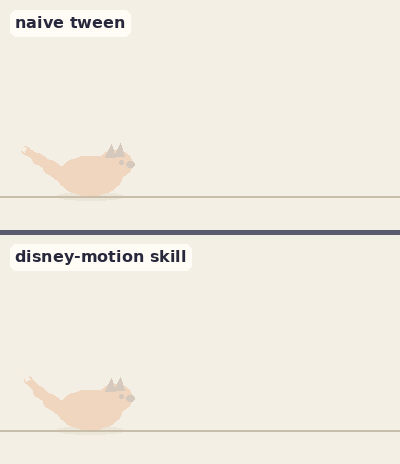

# Disney Motion Skill

A Skill that teaches AI agents to animate like Disney animators, with a checker that catches lifeless motion before you see it.



*The same creature and the same hop. The top row is the usual result when an agent animates in code: linear tweens, a rigid tail, a blob that changes size, a shake that stops dead. The bottom row follows this skill: a wind-up, an arc, squash that keeps its volume, a tail that drags and whips, a shake that decays, and a breathing hold. Both rows are made by [`examples/hop_demo.py`](examples/hop_demo.py).*

## Why

Tell an AI to "follow Disney's 12 principles" and it usually adds all twelve at once, so everything wobbles. Disney's animators used the principles for acting: you see the thought, then the action, then the reaction. This skill gives your agent three things:

- **A method.** Beat sheet first, then poses, then timing, then the principles where they serve the beat.
- **Numbers instead of adjectives.** Every principle becomes an operator with defaults: lag in frames, spring damping, squash with volume kept, anticipation as a fraction of the travel. An exaggeration dial goes from calm product UI to full cartoon.
- **A checker.** `scripts/motion_check.py` reads the animation curves, sampled once per frame, and flags robot easing, squash that changes the volume, welded tails, jelly wobble, moves that start cold, straight paths and dead holds. The agent can check its own motion before you look at it. It needs no screenshots, no model calls and nothing outside the Python standard library. A clean report does not mean the motion is appealing: it means none of these known faults was found. You still watch the result.

```
$ python3 scripts/motion_check.py tracks examples/out/naive.tracks.json
FAIL ease [body.x]: frames 12-40: constant speed from start to stop. Add slow in / slow out, ...
WARN jelly [body.rot]: frames 52-76: 6 swings that barely shrink (median ratio 1.00). ...
WARN anticipation [body.x]: big move(s) at frame 12 start cold. ...
FAIL volume [body.sx*body.sy]: volume off by 8% at frame 22. ...
FAIL overlap [body.rot -> tail1.rot -> ...]: body.rot->tail1.rot, ... move on the same frame. ...
FAIL: 3 fail, 15 warn

$ python3 scripts/motion_check.py tracks examples/out/disney.tracks.json
PASS: 0 fail, 0 warn
```

## Use it

Give this repository's link to your agent (Claude Code, Codex, Cursor or any agent that reads skills) and tell it to install the skill. Or install it yourself:

```bash
git clone https://github.com/BearThreat/disney-motion-skill ~/.claude/skills/disney-motion
```

The skill costs almost no context until it is needed. The agent sees only a one-line description at startup, and loads the full skill only when the task is about animation. The code recipes and UI numbers load only when the agent writes that code. For other agents and for the check commands, see [references/setup.md](references/setup.md).

Then ask for motion as you normally do: "make the fox jump onto the rock", "the loading mascot feels stiff", "animate this card flip so it feels alive".

## What is inside

| File | Loaded when | Contents |
|---|---|---|
| [`SKILL.md`](SKILL.md) | The task involves animation | Method, dial, 12 principles as operators, failure modes, edge cases |
| [`references/recipes.md`](references/recipes.md) | The agent writes the code | Springs, chain overlap, squash, anticipation, arcs, holds; notes for Three.js, GSAP, Motion, CSS, Remotion, Lottie, Blender |
| [`references/ui.md`](references/ui.md) | The motion is product UI | Durations, easings, springs, reduced motion |
| [`scripts/motion_check.py`](scripts/motion_check.py) | The agent checks its work | Track checker, cubic-bezier overshoot, spring damping and settle time. Its docstring lists every check and where it runs. |
| [`examples/tracks.example.json`](examples/tracks.example.json) | The agent writes a track file | A short valid file to copy |
| [`examples/hop_demo.py`](examples/hop_demo.py) | You want a worked example | The GIF above, as code |

## Credits

Inspired by [this post](https://x.com/endel/status/2125224240488354066). The principles come from Frank Thomas and Ollie Johnston, *The Illusion of Life: Disney Animation* (1981). This project is not affiliated with The Walt Disney Company.

MIT License.
